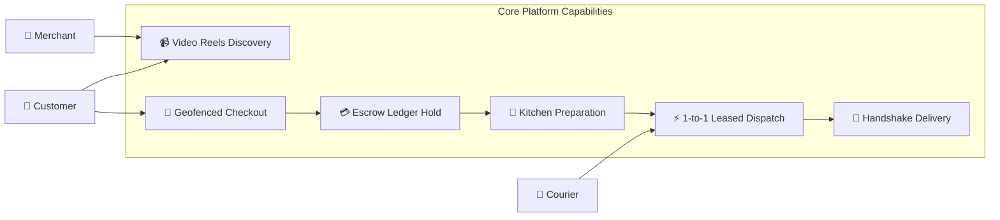
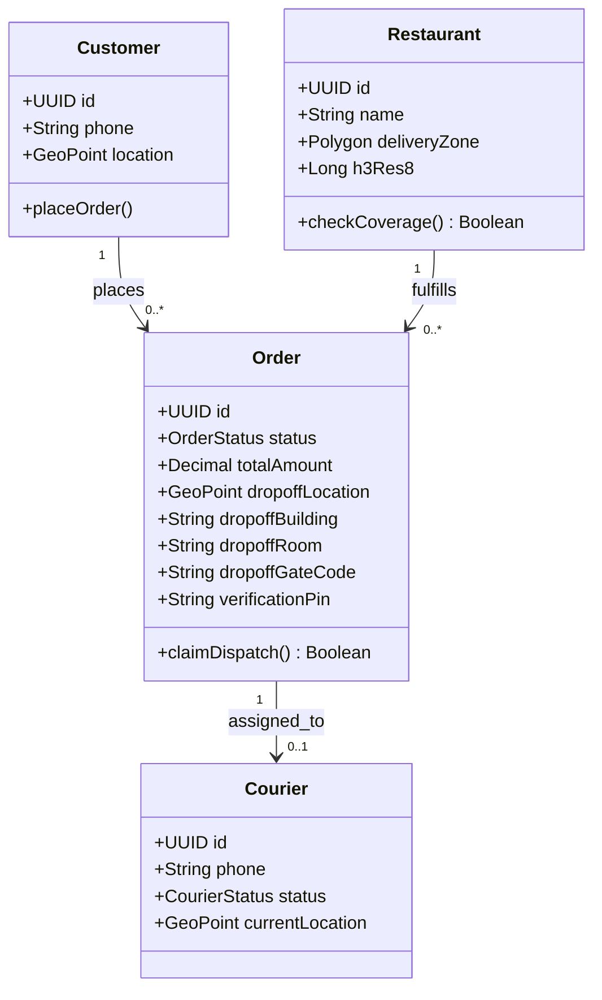
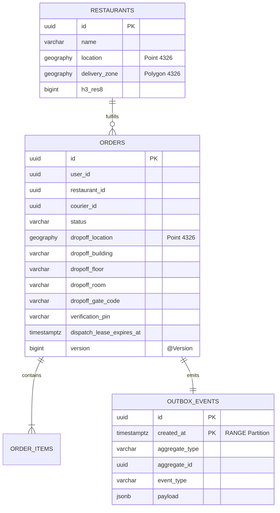

<div align="center">

# 🚀 Sovereign Hyper-Local Video & Food Delivery Platform

**A 100% Offline, High-Concurrency, Geodesic-Accurate Food & Short-Form Video Delivery Engine**

[](https://openjdk.org/projects/jdk/21/)
[](https://spring.io/projects/spring-boot)
[](https://postgis.net/)
[](https://kubernetes.io/)
[](https://www.docker.com/)
[](LICENSE)

<br/>

[Architecture](docs/ARCHITECTURE.md) • [API Reference](docs/API_REFERENCE.md) • [Operations Runbook](docs/RUNBOOK.md) • [Contributing](CONTRIBUTING.md)

</div>

---

## ⚡ Executive Summary

The **Sovereign Hyper-Local Video & Food Delivery Platform** is an enterprise-grade backend engineered for ultra-dense local food commerce, location-gated video streaming reels, and turn-by-turn road routing. Built to operate **100% offline and self-contained**, it eliminates runtime cloud SaaS dependencies while binding **strictly to a single host port (`8080`)**.

```
┌────────────────────────────────────────────────────────────────────────────────────────┐
│                              CORE ARCHITECTURAL PILLARS                                │
├────────────────────────────┬─────────────────────────────┬─────────────────────────────┤
│   100% Offline & Sovereign │  Single Host Port (8080)    │  Geodesic CRS Precision     │
│   Zero runtime cloud SaaS  │  Strict CNI encapsulation   │  EPSG:4326 PostGIS only     │
│   Internal boundary mocks  │  Path-based L7 gateway      │  ST_Covers on WGS 84        │
├────────────────────────────┼─────────────────────────────┼─────────────────────────────┤
│   Deterministic Dispatch   │  Zero-WAL Outbox Hardening  │  Hardware GPU Acceleration  │
│   1-to-1 30s lease locks   │  Daily table partitioning   │  AMD Radeon RX 7900 GRE     │
│   Anti-race conditional DB │  Pruning via DROP TABLE     │  Mesa VAAPI HLS transcoding │
└────────────────────────────┴─────────────────────────────┴─────────────────────────────┘
```

---

## 🌟 Key Features

* **100% Offline & Sovereign:** Replaces Twilio, Stripe, APNs, FCM, and Cloudflare Turnstile with dedicated containerized boundary services (`local-payment-service`, `local-sms-gateway`, `ntfy`).
* **Single Host Port Ingress (`8080`):** Solves workstation port collision by exposing exactly port `8080`. All inter-service communication traverses the internal Kubernetes Container Network Interface (CNI).
* **Geodesic Spatial Precision (`EPSG:4326`):** Eliminates up to 40% latitude area distortion from Web Mercator (`EPSG:3857`). Boundaries and drop-offs use `geography(Polygon, 4326)` and `geography(Point, 4326)` evaluated natively via `ST_Covers`.
* **Hyper-Local Dropoff Geometry:** Orders capture precise multi-tenant delivery metadata: building, floor, room number, gate code, and 6-digit handshake PIN.
* **Deterministic 1-to-1 Dispatch Leases:** Eliminates broadcast race conditions with server-authoritative 30-second lease state progression (`dispatch_lease_expires_at > NOW()`).
* **Zero-WAL Outbox Partitioning:** `outbox_events` is declaratively partitioned by day and pruned via scheduled `DROP TABLE` calls, leaving **0 dead rows in PostgreSQL WAL**.

---

## 📐 Model-Driven Architecture (MDA)

The system isolates domain logic from infrastructure across OMG Model-Driven Architecture (MDA) layers:

### 1. Computation-Independent Model (CIM)
Captures real-world domain actors and business capabilities:



### 2. Platform-Independent Model (PIM)
Class models, state progressions, and concurrency contracts:



### 3. Platform-Specific Model (PSM)
Relational DDL, Geodesic PostGIS 4326 geography, and partitioned transactional outbox:



> 📖 *For complete sequence diagrams, state machines, and mathematical proofs, see [`docs/ARCHITECTURE.md`](docs/ARCHITECTURE.md).*

---

## 🌐 Unified Single Ingress Gateway (Port 8080)

All external traffic terminates strictly at **Host Port 8080**:

| Path Pattern | Target Microservice | Protocol | Description |
| :--- | :--- | :--- | :--- |
| `/api/v1/catalog/*` | `catalog-service:8080` | HTTP/2 | Restaurant onboarding, menus, `ST_Covers` geofencing |
| `/api/v1/orders/*` | `order-service:8080` | HTTP/2 | Order checkout, dispatch leases, outbox admin |
| `/api/v1/payments/*` | `local-payment-service:8080` | HTTP/2 | Double-entry balance holds, captures, refunds |
| `/api/v1/sms/*` | `local-sms-gateway:8080` | HTTP/2 | High-throughput mock SMS sending & instant OTP inspection |
| `/admin/sms-inbox` | `local-sms-gateway:8080` | HTML/SSE | Real-time web inbox for manual QA testing |
| `/push/*` | `ntfy:80` | HTTP & WS | Sovereign push notifications & WebSockets |

---

## 🚀 Quickstart

### 1. Prerequisites
* **Java 21** (`java -version`)
* **Docker Engine 26+** (`docker ps`)
* **Git**

### 2. Run All Automated Verification Gates (Unit & Integration)
```bash
git clone https://github.com/BlackPool25/delivery-platform.git
cd delivery-platform

# Compiles and runs all test suites with Testcontainers PostGIS
./mvnw clean test
```

### 3. Start Local Microservices Cluster via Docker Compose
```bash
docker compose -f docker/docker-compose-phase2.yaml up -d --build
```

### 4. Verify Gateway Health
```bash
# Verify Catalog Service
curl -s http://localhost:8085/actuator/health | jq .

# Verify Order Service
curl -s http://localhost:8086/actuator/health | jq .

# Verify Payment Ledger
curl -s http://localhost:8082/actuator/health | jq .

# Verify SMS Gateway
curl -s http://localhost:8083/actuator/health | jq .
```

---

## 🧪 Verification Gates & Execution Proof

### Phase 2 Verification Results
```text
[INFO] Reactor Summary:
[INFO] 
[INFO] delivery-platform .................................. SUCCESS
[INFO] local-payment-service .............................. SUCCESS
[INFO] local-sms-gateway .................................. SUCCESS
[INFO] catalog-service .................................... SUCCESS (PostGIS ST_Covers Gate: PASSED)
[INFO] order-service ...................................... SUCCESS (Zero-WAL Outbox Prune Gate: PASSED)
[INFO] ------------------------------------------------------------------------
[INFO] BUILD SUCCESS
```

1. **PostGIS `ST_Covers` Geodesic Precision Test:**
   * Interior Point (`-122.4150, 37.7750`) $\rightarrow$ `ST_Covers = true`.
   * Boundary Edge Point (`-122.4000, 37.7750`) $\rightarrow$ `ST_Covers = true` (validates boundary acceptance on WGS84 ellipsoid).
   * Exterior Point (`-122.5000, 37.7750`) $\rightarrow$ `ST_Covers = false`.
2. **Zero-WAL Outbox Pruning Test:**
   * Pre-creates upcoming daily range partitions (`outbox_events_yYYYYmMMdDD`).
   * Evaluates expired partitions older than 7 days.
   * Executes `DROP TABLE` to instantly reclaim disk blocks with **`n_dead_tup == 0`** dead tuples.

---

## 📂 Repository Layout

```text
delivery-platform/
├── .github/workflows/          # Automated GitHub Actions CI workflow
├── docker/
│   ├── docker-compose-phase2.yaml # Local 100% offline stack composition
│   └── postgresql.conf         # Hardened CDC & max_slot_wal_keep_size=-1
├── docs/
│   ├── ARCHITECTURE.md         # Full MDA specification & Mermaid diagrams
│   ├── API_REFERENCE.md        # Complete OpenAPI / REST documentation
│   └── RUNBOOK.md              # Operations, failure modes, and recovery
├── k8s/
│   ├── catalog-service/        # Kubernetes manifests with strict resource budget
│   ├── ingress/                # Single-port (8080) L7 routing definitions
│   ├── order-service/          # Deployment with requests: 300m/512Mi, limits: 1500m/1024Mi
│   └── postgres/               # PostGIS 16 StatefulSet with logical replication
├── migrations/                 # Centralized Flyway DDL migrations
├── services/
│   ├── catalog-service/        # Spring Boot 3 PostGIS catalog microservice
│   ├── local-payment-service/  # Internal double-entry ledger gateway
│   ├── local-sms-gateway/      # In-memory circular buffer SMS gateway
│   └── order-service/          # Order checkout, dispatch leases & outbox pruning
├── pom.xml                     # Maven parent multi-module definition
└── CONTRIBUTING.md             # Developer guidelines & zero-TODO contracts
```

---

## 📜 License

Licensed under the [MIT License](LICENSE). Copyright © 2026 Shreyas S Joshi.
