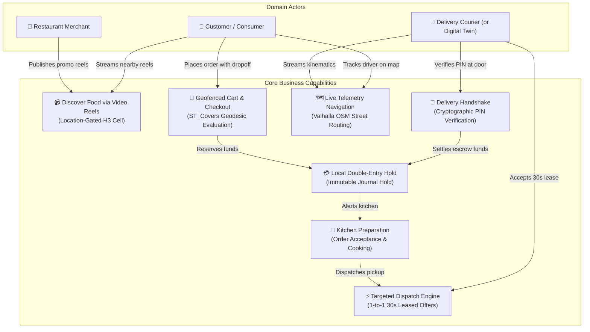
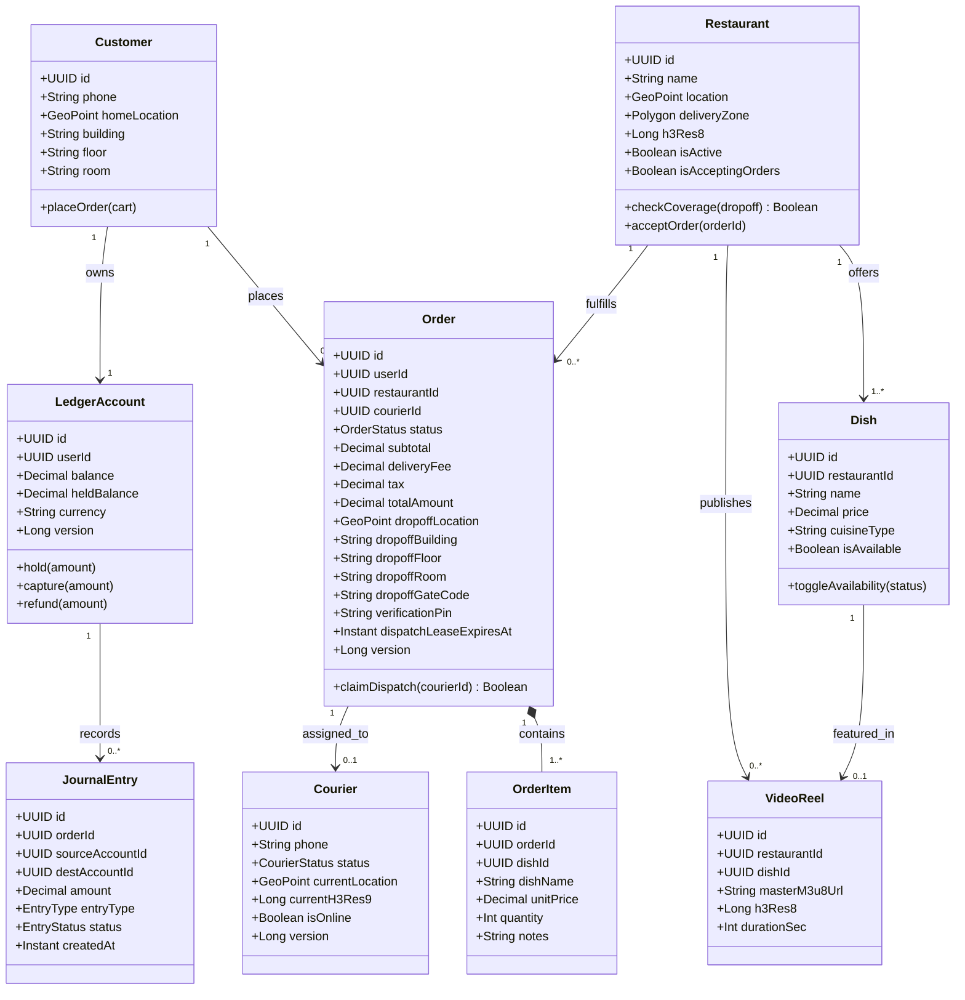
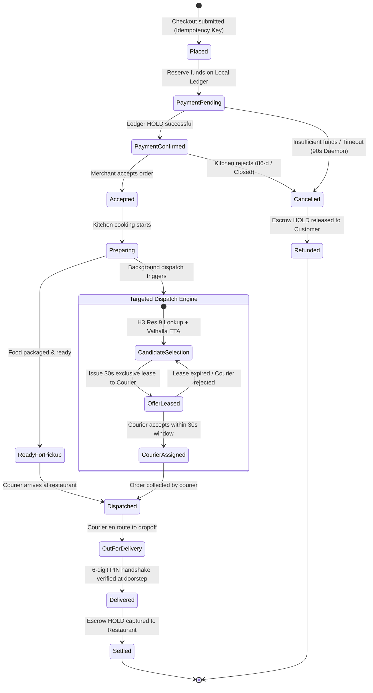
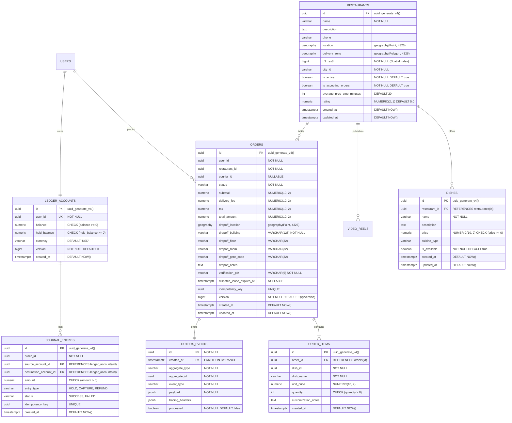
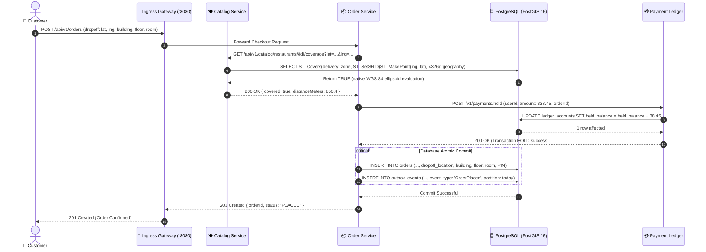
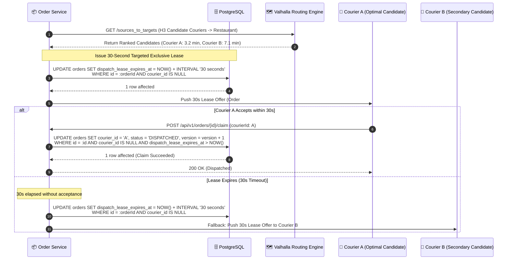
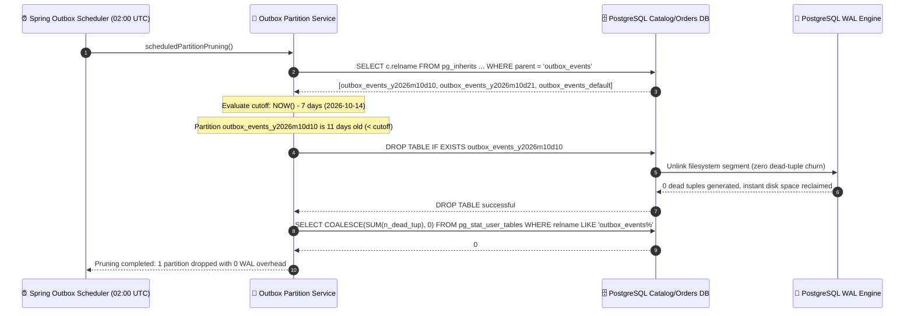

# System Architecture Specification & Model-Driven Architecture (MDA)

> **Sovereign Hyper-Local Video & Food Delivery Platform**  
> *Production-Grade Architecture Specification with Zero External SaaS Runtime Dependencies*

---

## 1. Executive Summary & Core Engineering Tenets

The delivery platform is an enterprise-scale distributed system built for high-concurrency hyper-local commerce, short-form food discovery video streaming, real-time spatial routing, and offline-first sovereign deployment.

### Non-Negotiable Architectural Tenets

```
┌────────────────────────────────────────────────────────────────────────────────────────┐
│                                ARCHITECTURAL PILLARS                                  │
├────────────────────────────┬─────────────────────────────┬─────────────────────────────┤
│   100% Offline & Sovereign │  Single Host Port (8080)    │  Geodesic CRS Precision     │
│   Zero runtime cloud SaaS  │  Strict CNI encapsulation   │  EPSG:4326 PostGIS only     │
│   Internal boundary mocks  │  Path-based L7 gateway      │  ST_Covers on WGS 84        │
├────────────────────────────┼─────────────────────────────┼─────────────────────────────┤
│   Deterministic Dispatch   │  Zero-WAL Outbox Hardening  │  Hardware GPU Acceleration  │
│   1-to-1 30s lease locks   │  Daily table partitioning   │  AMD Radeon RX 7900 GRE     │
│   Anti-race conditional DB │  Pruning via DROP TABLE     │  Mesa VAAPI HLS transcoding │
└────────────────────────────┴─────────────────────────────┴─────────────────────────────┘
```

1. **100% Offline & Sovereign (Zero Cloud SaaS):** Operates entirely disconnected from public internet at runtime. All external services (Stripe, Twilio, Google FCM, Apple APNs) are substituted by dedicated local containerized boundary services (`local-payment-service`, `local-sms-gateway`, `ntfy`).
2. **Single Host Port Ingress (Port 8080):** Exactly one host port (`8080`) is exposed on the host machine. All inter-service traffic flows over the internal Kubernetes Container Network Interface (CNI) via ClusterIPs and CoreDNS.
3. **Geodesic Spatial Precision (EPSG:4326 PostGIS):** Flawed Web Mercator (EPSG:3857) planar projections are strictly prohibited. Delivery zones and coordinates use `geography(Polygon, 4326)` and `geography(Point, 4326)` evaluated with native `ST_Covers`.
4. **Deterministic Concurrency & Hardened CDC Outbox:** Order dispatch is governed by server-authoritative 30-second 1-to-1 leases. The Transactional Outbox table is declaratively partitioned by day and pruned via `DROP TABLE` to guarantee **0 dead row WAL churn**.

---

## 2. Model-Driven Architecture (MDA) Realization

The system decouples core business logic from infrastructure using OMG's Model-Driven Architecture (MDA) layers:

```
┌───────────────────────────────────────────────────────────────────────────┐
│              CIM: Computation-Independent Model                           │
│  Domain Actors, Business Capabilities & Real-World Food Delivery Workflows│
└─────────────────────────────────────┬─────────────────────────────────────┘
                                      │
                                      ▼
┌───────────────────────────────────────────────────────────────────────────┐
│              PIM: Platform-Independent Model                              │
│  Logical Class Models, State Progression & Concurrency Contracts           │
└─────────────────────────────────────┬─────────────────────────────────────┘
                                      │
                                      ▼
┌───────────────────────────────────────────────────────────────────────────┐
│              PSM: Platform-Specific Model                                 │
│  PostgreSQL/PostGIS 16 Relational Schema, Partitioning, CNI Networking    │
└───────────────────────────────────────────────────────────────────────────┘
```

---

### 2.1 Computation-Independent Model (CIM): Business Capabilities & Actors

The CIM captures the real-world actors, business capabilities, and organizational workflows without technical implementation details.



---

### 2.2 Platform-Independent Model (PIM): Structural & Behavioral Realization

#### A. Logical Domain Class Architecture

The PIM formalizes the structural relationships, attributes, and cardinality among core domain concepts.



---

#### B. Deterministic Order Lifecycle State Machine (Targeted 1-to-1 Lease)

Eliminates dispatch race conditions and broadcast noise by strictly issuing targeted 30-second leases to the optimal courier candidate:



---

### 2.3 Platform-Specific Model (PSM): Relational, PostGIS & Partitioned Schema

The PSM translates the platform-independent concepts into optimized physical tables, spatial geometries, indexes, and range partitions:



---

## 3. High-Fidelity Sequence Interactions

### 3.1 Order Checkout, Spatial Geofence Verification & Transactional Outbox



---

### 3.2 Targeted 1-to-1 Dispatch Lease State Progression



---

### 3.3 Zero-WAL Outbox Partition Pruning via `DROP TABLE`



---

## 4. Kubernetes Single-Port Ingress Topology

Only **host port 8080** is bound. All internal services communicate over the Kubernetes CNI pod network:

```
                          [ Host Workstation Browser / Test Harness ]
                                              │
                                              │ HTTP / WebSockets (Port 8080 Only)
                                              ▼
        ┌───────────────────────────────────────────────────────────────────────────┐
        │             Kubernetes Ingress Controller (Host Port 8080)                │
        └─────────────────────────────────────┬─────────────────────────────────────┘
                                              │
   ┌──────────────────────────────────────────┴──────────────────────────────────────────┐
   │                       Kubernetes CNI Pod Network (Pod CIDR)                         │
   │                                                                                     │
   │  ├──> /api/v1/catalog/*     ──> catalog-service.delivery-prod.svc:8080              │
   │  ├──> /api/v1/orders/*      ──> order-service.delivery-prod.svc:8080                │
   │  ├──> /api/v1/payments/*    ──> local-payment-service.delivery-prod.svc:8080        │
   │  ├──> /api/v1/sms/*         ──> local-sms-gateway.delivery-prod.svc:8080            │
   │  ├──> /admin/sms-inbox      ──> local-sms-gateway.delivery-prod.svc:8080            │
   │  └──> /push/*               ──> ntfy.delivery-prod.svc:80 (WebSockets/SSE)         │
   │                                                                                     │
   │  Datastores (Internal ClusterIP):                                                   │
   │  ├── postgres.delivery-prod.svc:5432 (PostGIS 16 Hardened CDC)                      │
   │  ├── redis.delivery-prod.svc:6379                                                   │
   │  └── kafka.delivery-prod.svc:9092                                                   │
   └─────────────────────────────────────────────────────────────────────────────────────┘
```

---

## 5. Workstation Resource Budget & Mathematical Safety Proof

All pods declare strict requests and limits matching Section 4.2 of `plan.md`:

| Component | Pod Name | CPU Request | CPU Limit | RAM Request | RAM Limit | Quality of Service |
| :--- | :--- | :--- | :--- | :--- | :--- | :--- |
| **Datastores** | `postgres` (PostGIS 16) | `500m` | `2000m` | `1536Mi` | `3072Mi` | Burstable |
| **Core Service** | `catalog-service` | `200m` | `1000m` | `384Mi` | `768Mi` | Burstable |
| **Core Service** | `order-service` | `300m` | `1500m` | `512Mi` | `1024Mi` | Burstable |
| **Local Boundary**| `local-payment-service` | `100m` | `500m` | `256Mi` | `384Mi` | Burstable |
| **Local Boundary**| `local-sms-gateway` | `50m` | `200m` | `64Mi` | `128Mi` | Burstable |
| **Local Boundary**| `ntfy` | `50m` | `200m` | `64Mi` | `128Mi` | Burstable |
| **Ingress** | `ingress-nginx` | `100m` | `500m` | `128Mi` | `256Mi` | Burstable |

### Mathematical Proof of Workstation Stability
1. **Guaranteed Scheduling (`Requests = 2.9 GB RAM / 1.3 vCPUs`):** A standard 16GB–32GB developer machine satisfies requests instantaneously with zero Kubelet node eviction pressure.
2. **Hard Burst Ceiling (`Limits = 6.7 GB RAM / 6.7 vCPUs`):** During maximum load, cgroup limits clamp container resource consumption, reserving 9GB to 25GB of host RAM for the OS, IDE, and developer tools. Kernel OOM panics are prevented.
