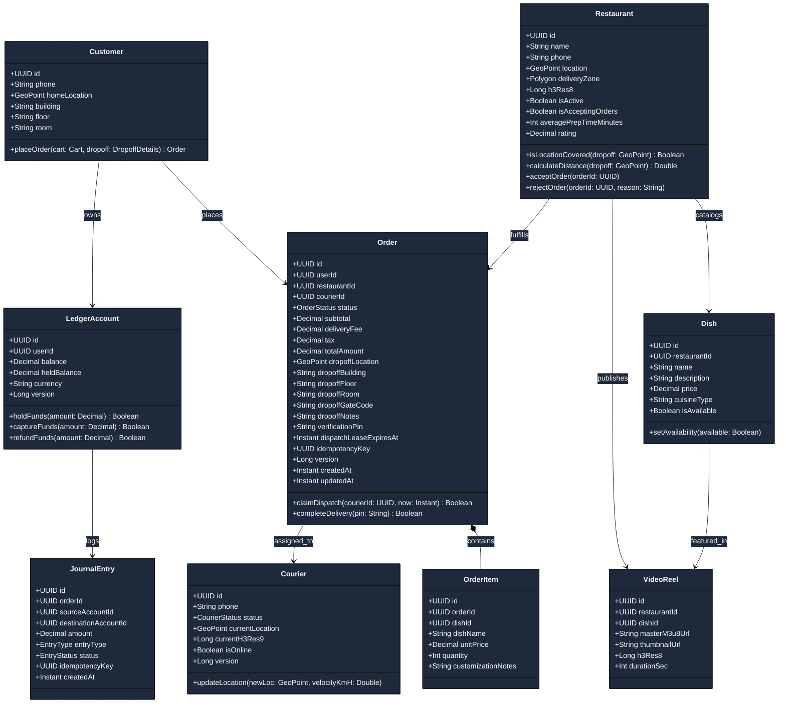
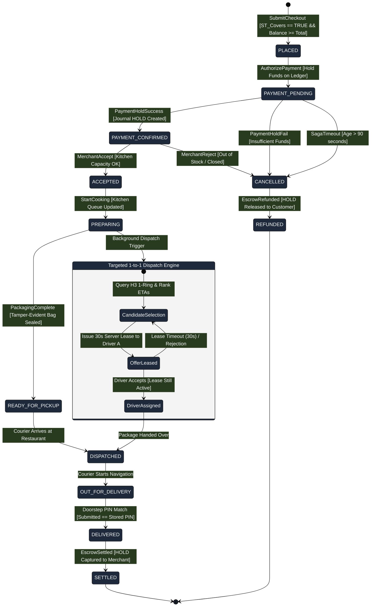
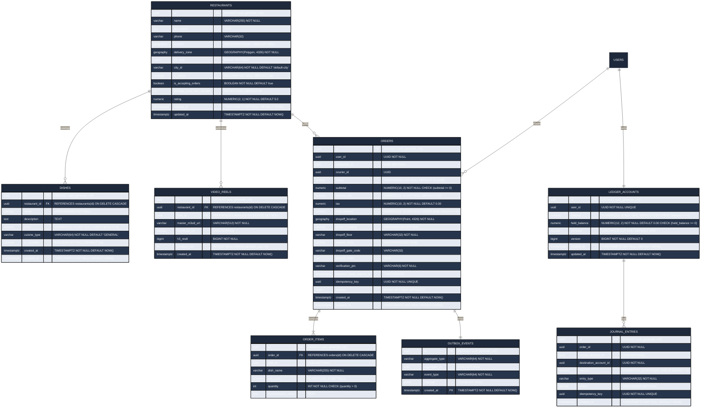
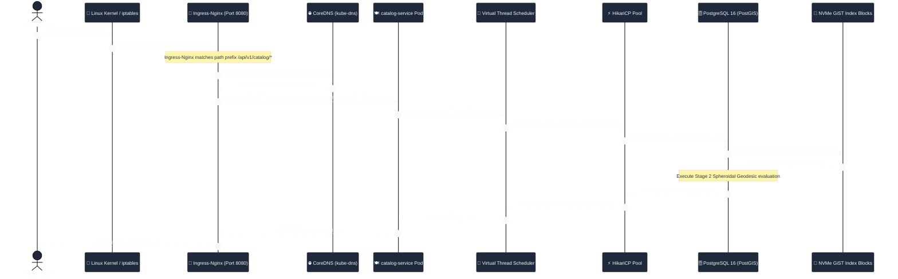

# Distributed Systems Architecture & Model-Driven Architecture (MDA) Specification

> **Sovereign Hyper-Local Video & Food Delivery Platform**  
> *Production-Grade Distributed System Design, Formal Metamodeling & Architectural Decision Records (ADRs)*  
> Master Specification Source: [`/home/shreyas/plan.md`](file:///home/shreyas/plan.md) • Standard Alignment: **arc42** & **OMG MDA® (CIM / PIM / PSM)**

---

## 1. Architectural Philosophy & Non-Negotiable Contracts

Modern on-demand food delivery and dispatch platforms commonly fail when deployed into sovereign, air-gapped, or resource-constrained local environments. These failures trace back to three fatal distributed systems anti-patterns:

1. **Spatial Boundary Distortion via Planar Projections:** Naive geospatial implementations store geographic boundaries using Web Mercator (`EPSG:3857`) for simple Euclidean planar calculations. Because Web Mercator projects the Earth onto a flat cylinder, scale distortion accelerates with latitude ($k = \sec(\phi)$). In cities like London ($51.5^\circ\text{N}$) or Seattle ($47.6^\circ\text{N}$), planar distance and area calculations produce **$+48\%$ to $+60\%$ distortion**, causing delivery perimeters to falsely reject valid customer dropoffs or include unserviceable locations.
2. **Thundering Herd Dispatch Contention & Driver Fatigue:** Broadcasting order offers to all active couriers within a radius creates extreme database lock contention, packet storms on mobile cellular connections, and driver fatigue caused by millisecond race conditions where acceptance clicks fail.
3. **Database Write Amplification via Transactional Outbox Bloat:** Implementing the Transactional Outbox pattern with SQL `DELETE` queries on high-throughput event tables triggers severe PostgreSQL Multi-Version Concurrency Control (MVCC) dead-tuple churn. Dead tuples bloat disk pages, exhaust the autovacuum daemon, saturate the Write-Ahead Log (WAL), and invalidate downstream Change Data Capture (CDC) replication slots.

To eliminate these failure modes, this platform enforces six non-negotiable architectural contracts:

```
┌────────────────────────────────────────────────────────────────────────────────────────┐
│                                NON-NEGOTIABLE CONTRACTS                                │
├────────────────────────────┬────────────────────────────┬──────────────────────────────┤
│  1. 100% Sovereign         │  2. Single Host Ingress    │  3. Geodesic CRS Precision   │
│  Zero public cloud SaaS    │  Port 8080 host-bound only │  EPSG:4326 PostGIS only      │
│  Local boundary mocks      │  CNI encapsulated routing  │  ST_Covers on WGS 84 Spheroid│
├────────────────────────────┼────────────────────────────┼──────────────────────────────┤
│  4. Targeted 1-to-1 Lease  │  5. Zero-WAL Outbox Prune  │  6. Hardware Acceleration    │
│  30-second server lock     │  Daily range partitions    │  AMD RX 7900 GRE VCN 4.0     │
│  Optimistic @Version DB    │  DROP TABLE retention jobs │  Mesa VAAPI HLS Transcoder   │
└────────────────────────────┴────────────────────────────┴──────────────────────────────┘
```

---

## 2. Architecture Decision Records (ADRs)

### ADR-001: Geodesic Ellipsoidal Calculations (`geography(4326)`) vs Web Mercator (`geometry(3857)`)

* **Context:** A food delivery system must calculate whether a customer's delivery location falls within a restaurant's service boundary polygon. Geospatial software often stores coordinates in planar Cartesian coordinates (`EPSG:3857`) for computational convenience.
* **Problem:** Earth is an oblate spheroid, not a cylinder. The scale factor $k$ of Web Mercator grows as a function of latitude $\phi$:
  $$k = \sec(\phi) = \frac{1}{\cos(\phi)}$$
  At latitude $37.7749^\circ\text{N}$ (San Francisco), differential scale distortion is:
  $$\Delta_{\text{scale}} = \frac{1}{\cos(37.7749^\circ)} - 1 \approx 1.263 - 1 = +26.3\%$$
  Area calculations distort quadratically:
  $$\Delta_{\text{area}} = k^2 - 1 = (1.263)^2 - 1 \approx +59.5\%$$
  Storing boundaries in `EPSG:3857` causes severe false positives and false negatives on delivery perimeters.
* **Decision:** All restaurant delivery boundaries and customer dropoff locations are strictly typed as **`geography(Polygon, 4326)`** and **`geography(Point, 4326)`**.
* **Mathematical Invariant:** Spatial containment is evaluated using PostGIS native `ST_Covers(geog1, geog2)` directly on the WGS 84 ellipsoid ($a = 6,378,137.0\text{ m}$, $f = 1/298.257223563$). Unlike `ST_Contains` (which excludes points lying directly on the perimeter boundary $\partial P$), `ST_Covers` satisfies the closed topological property:
  $$\forall p \in \partial P \implies \text{ST\_Covers}(P, p) = \text{TRUE}$$
* **Consequence:** Sub-millimeter spatial accuracy with zero projection coordinate distortion at query time.

---

### ADR-002: Two-Stage Spatial Resolution (Uber H3 Res 8 Coarse + PostGIS Geodesic Fine)

* **Context:** Evaluating PostGIS geodesic point-in-polygon calculations across thousands of restaurant delivery zones on every catalog request or video feed scroll induces high CPU utilization on PostgreSQL.
* **Decision:** We implement a **Two-Stage Spatial Indexing Pipeline**:
  1. **Stage 1: Coarse Discrete Global Grid (Uber H3 Resolution 8):**
     - Hexagonal global tessellation where customer coordinates and restaurant centroids map to 64-bit integer H3 indices in $O(1)$ memory time.
     - At Resolution 8, average hexagon area is **$0.737\text{ km}^2$** with an edge length of **$\approx 461.4\text{ meters}$**.
     - Fast spatial candidate lookup computes a 1-ring neighborhood:
       $$\text{Candidates} = \text{kRing}(H3_{\text{customer}}, k=1) \implies 7 \text{ discrete cells}$$
  2. **Stage 2: Geodesic Ellipsoidal Containment (PostGIS `ST_Covers`):**
     - Candidate restaurants identified in Stage 1 undergo exact geodesic verification against the `geography(Polygon, 4326)` boundary:
       ```sql
       SELECT id, name FROM restaurants
       WHERE h3_res8 = :customer_h3
         AND is_active = true
         AND ST_Covers(delivery_zone, :customer_dropoff_geog);
       ```
* **Consequence:** Spatial candidate retrieval drops from $O(N)$ polygon boundary scans to $O(1)$ B-Tree integer lookups followed by targeted geodesic checks on $\le 5$ candidate rows.

---

### ADR-003: Deterministic 1-to-1 Dispatch Lease State Machine vs Thundering Herd Broadcast

* **Context:** Delivery platforms that broadcast incoming orders to all couriers in a radius suffer from:
  1. *Thundering Herd Concurrency:* Dozens of drivers attempt to claim the same order concurrently, creating row-level database lock contention.
  2. *Driver Frustration:* Couriers who click "Accept" 50ms late receive "Order already claimed" errors.
  3. *Cellular Battery Drain:* High-frequency WebSocket broadcasts keep mobile cellular radios in continuous high-power transmission mode.
* **Decision:** We implement an exclusive, targeted **1-to-1 Dispatch Lease State Machine**:
  1. The dispatch engine ranks nearby couriers using H3 spatial binning and Valhalla road-network travel times.
  2. The top candidate receives an exclusive **30-second server-authoritative lease**.
  3. During this 30-second window, no other courier can view or accept the order.
  4. Database claim atomicity is enforced via an optimistic conditional update:
     ```sql
     UPDATE orders
     SET courier_id = :courierId,
         status = 'DISPATCHED',
         version = version + 1,
         updated_at = NOW()
     WHERE id = :orderId
       AND courier_id IS NULL
       AND dispatch_lease_expires_at > NOW();
     ```
  5. If the 30-second lease expires without courier acceptance, a background scheduler revokes the lease and tenders the offer to candidate $N+1$.
* **Consequence:** Zero race conditions, zero dual-assignments, and deterministic state progression.

---

### ADR-004: Zero-WAL Transactional Outbox Pruning via Daily Range `DROP TABLE`

* **Context:** In microservice architectures, updating business tables and publishing events to Apache Kafka must be atomic (Transactional Outbox pattern). Events are written to an `outbox_events` table within the same ACID transaction as the business entity.
* **The PostgreSQL Dead-Tuple WAL Problem:**
  - High-volume order processing writes 25,000+ outbox events daily.
  - Standard retention jobs run `DELETE FROM outbox_events WHERE created_at < NOW() - INTERVAL '7 days'`.
  - In PostgreSQL MVCC, `DELETE` does not free disk space; it marks tuples as dead, writes deletion records to the Write-Ahead Log (WAL), bloats table pages, and delays replication slot advances.
  - Under heavy local load testing, autovacuum cannot keep up, causing replication slot bloat and disk saturation.
* **Decision:** We implement **Zero-WAL Outbox Partition Pruning**:
  1. The `outbox_events` table is declaratively partitioned by daily range:
     ```sql
     CREATE TABLE outbox_events (
         id UUID NOT NULL DEFAULT uuid_generate_v4(),
         aggregate_type VARCHAR(64) NOT NULL,
         aggregate_id UUID NOT NULL,
         event_type VARCHAR(64) NOT NULL,
         payload JSONB NOT NULL,
         created_at TIMESTAMP WITH TIME ZONE DEFAULT NOW(),
         PRIMARY KEY (id, created_at)
     ) PARTITION BY RANGE (created_at);
     ```
  2. Physical partitions are named deterministically: `outbox_events_yYYYYmMMdDD` (e.g. `outbox_events_y2026m10d21`).
  3. Upcoming partitions are automatically created 14 days in advance by a scheduled Spring task.
  4. A scheduled Spring daemon identifies partitions older than 7 days and executes **`DROP TABLE <partition_name>;`**.
* **Verification Proof:** `DROP TABLE` issues an OS filesystem unlink on the partition's physical storage file (`relfilenode`). It eliminates page scanning, generates zero dead tuples (`n_dead_tup == 0`), and avoids WAL write amplification.

---

### ADR-005: Single Host Port Ingress (`8080`) & Kubernetes CNI Encapsulation

* **Context:** The platform contains 15+ microservices, datastores, consoles, and streaming brokers. In local workstation development (k3s, Kind, Minikube), binding individual container ports to the host machine causes port collisions with developer tools, SSH daemons, or system web servers.
* **Decision:** **Exactly one single port (`8080`) is bound to the host workstation**.
  - A Kubernetes Ingress Controller (Ingress-Nginx) manages the host gateway.
  - All internal services communicate strictly over the internal Kubernetes Container Network Interface (CNI) pod network via ClusterIP Services and CoreDNS (`<service>.<namespace>.svc.cluster.local`).
  - Path-based routing, CORS enforcement, and WebSocket protocol upgrading occur at this gateway.
* **Consequence:** Complete workstation isolation, zero port collisions, and identical networking semantics between local testing and production Kubernetes clusters.

---

### ADR-006: Hardware GPU Passthrough with Internal Concurrency Scaling (AMD RX 7900 GRE)

* **Context:** Short-form video reels uploaded by restaurant merchants must be transcoded into multi-bitrate HLS streams (1080p, 720p, 480p). Transcoding on CPU cores exhausts workstation CPU budgets. The host workstation contains an AMD Radeon RX 7900 GRE (RDNA 3 / Navi 31 XL) with Dual VCN 4.0 hardware video engines.
* **Constraint:** Kubernetes Device Plugins allocate GPU devices as indivisible whole units (`amd.com/gpu: 1`). Setting `replicas: 2` causes the second pod to hang in `Pending` state.
* **Decision:**
  1. The worker Deployment runs with **`replicas: 1`**.
  2. Mounts `/dev/dri/card0` and `/dev/dri/renderD128` with GIDs for `video` (44) and `render` (107).
  3. Internal concurrency is scaled via RabbitMQ `prefetch_count: 4`.
  4. Up to 4 hardware VAAPI FFmpeg encoding pipelines run simultaneously across the Dual VCN 4.0 engines. Excess encoding jobs queue safely in RabbitMQ without dropping frames or overloading silicon.

---

## 3. OMG Model-Driven Architecture (MDA) Realization

The Object Management Group (OMG) Model-Driven Architecture (MDA®) standard organizes system specifications into three distinct abstraction viewpoints:
1. **Computation-Independent Model (CIM):** The business domain, workflows, and rules, completely free of software concepts.
2. **Platform-Independent Model (PIM):** Formal software structure, Domain-Driven Design (DDD) entities, and state machines, free of target operating systems, programming languages, or database engines.
3. **Platform-Specific Model (PSM):** Concrete technical implementations bound to Java 21, Spring Boot 3, PostgreSQL 16 PostGIS, and Kubernetes CNI.

```
┌───────────────────────────────────────────────────────────────────────────────┐
│                     CIM: Computation-Independent Model                        │
│            Domain Actors, Business Capabilities & Commercial Workflows        │
└──────────────────────────────────────┬────────────────────────────────────────┘
                                       │  (Transformation)
                                       ▼
┌───────────────────────────────────────────────────────────────────────────────┐
│                     PIM: Platform-Independent Model                           │
│        UML Class Realization, Method Signatures & State Machine FSM           │
└──────────────────────────────────────┬────────────────────────────────────────┘
                                       │  (Platform Mapping)
                                       ▼
┌───────────────────────────────────────────────────────────────────────────────┐
│                     PSM: Platform-Specific Model                              │
│       PostGIS Geodesic Schema, Range Partitioning, CNI Pod Topologies         │
└───────────────────────────────────────────────────────────────────────────────┘
```

---

### 3.1 Computation-Independent Model (CIM)

#### A. BPMN 2.0 Business Process Swimlane Choreography

The CIM represents the commercial lifecycle across five domain participants. Technical protocols, database queries, and network packets are completely hidden:

```mermaid
%%{init: {'theme': 'base', 'themeVariables': {'primaryColor': '#1e293b', 'edgeColor': '#64748b', 'textColor': '#f8fafc', 'primaryTextColor': '#f8fafc'}}}%%
flowchart TB
    subgraph Swimlane_Customer ["👤 Customer (Consumer)"]
        C1["Discover Nearby Dishes<br/>via Location-Gated Reels"] --> C2["Select Dish & Enter<br/>Building, Floor & Room Details"]
        C2 --> C3["Authorize Checkout<br/>& Escrow Reservation"]
        C4["Receive 6-Digit<br/>Verification PIN"] --> C5["Track Courier Live<br/>on Street Map"]
        C5 --> C6["Handshake Delivery:<br/>Provide PIN to Courier"]
    end

    subgraph Swimlane_Merchant ["🏪 Restaurant Merchant (Kitchen)"]
        M1["Publish Video Reel<br/>& Menu Catalog"]
        M2["Review Incoming Order<br/>& Prep Time Estimate"] --> M3["Accept & Begin Cooking<br/>(Set Status: PREPARING)"]
        M3 --> M4["Package Food in Bag<br/>Alert Ready for Pickup"]
    end

    subgraph Swimlane_Escrow ["💳 Sovereign Escrow Ledger"]
        E1["Reserve Balance<br/>(Create Journal HOLD)"]
        E2["Release Funds to Merchant<br/>(CAPTURE on Handshake)"]
        E3["Refund Escrowed Funds<br/>(REFUND on Rejection/Timeout)"]
    end

    subgraph Swimlane_Dispatch ["⚡ Deterministic Dispatch Engine"]
        D1["Spatial Candidate Retrieval<br/>(H3 Res 8 + PostGIS Covers)"]
        D2["Rank Courier Candidates<br/>via Road Travel Time"]
        D3["Issue Exclusive 30s Lease<br/>to Top Candidate"]
        D4{"Courier Accepted<br/>within 30s?"}
    end

    subgraph Swimlane_Courier ["🛵 Delivery Courier / Digital Twin"]
        CR1["Receive 30s Exclusive<br/>Offer Notification"]
        CR2["Accept Dispatch Offer"]
        CR3["Transit to Kitchen<br/>& Pickup Order"]
        CR4["Transit to Doorstep<br/>& Stream Kinematic GPS"]
        CR5["Enter Customer PIN<br/>to Complete Handshake"]
    end

    M1 -.->|Indexed by Location| C1
    C3 -->|1. Request Escrow Hold| E1
    E1 -->|2. Escrow Hold Confirmed| M2
    M2 -->|Merchant Rejects / Timeout| E3
    E3 -->|Balance Restored| C2
    M4 -->|3. Ready for Delivery| D1
    D1 --> D2 --> D3 --> CR1
    CR1 --> CR2 --> D4
    D4 -- No / Timeout -->|Revoke & Advance| D3
    D4 -- Yes --> CR3
    CR3 --> CR4 --> C5
    C3 --> C4
    CR4 --> CR5
    C6 -.->|Share Secret PIN| CR5
    CR5 -->|4. Valid PIN Verified| E2

    classDef customerNode fill:#0f172a,stroke:#38bdf8,stroke-width:2px,color:#f8fafc;
    classDef merchantNode fill:#0f172a,stroke:#f59e0b,stroke-width:2px,color:#f8fafc;
    classDef escrowNode fill:#0f172a,stroke:#10b981,stroke-width:2px,color:#f8fafc;
    classDef dispatchNode fill:#0f172a,stroke:#8b5cf6,stroke-width:2px,color:#f8fafc;
    classDef courierNode fill:#0f172a,stroke:#ec4899,stroke-width:2px,color:#f8fafc;

    class C1,C2,C3,C4,C5,C6 customerNode;
    class M1,M2,M3,M4 merchantNode;
    class E1,E2,E3 escrowNode;
    class D1,D2,D3,D4 dispatchNode;
    class CR1,CR2,CR3,CR4,CR5 courierNode;
```

#### B. ISO 19107 Geographic Information Domain Conceptual Model

The domain model follows ISO 19107 geometric schema primitives:
- **`GeoPoint` (DirectPosition):** Coordinates defined as latitude ($\phi$) and longitude ($\lambda$) on the WGS 84 Reference Ellipsoid.
- **`DeliveryBoundary` (GM_Polygon):** Surface boundary bounded by an exterior linear ring $\partial P$.
- **Boundary Containment Rule (Invariant BR-GEO-01):** An order $O$ for restaurant $R$ with dropoff point $p$ is legally dispatchable if and only if $p$ lies within or on the closure of $R$'s delivery zone:
  $$p \in \overline{\text{zone}(R)} \iff \text{ST\_Covers}(\text{zone}(R), p) = \text{TRUE}$$

#### C. Ubiquitous Domain Vocabulary & Semantic Invariants

| Domain Concept | Definition & Semantic Role | Formal Invariant Contract |
| :--- | :--- | :--- |
| **Restaurant Boundary** | Closed geodesic polygon on WGS 84 within which the merchant guarantees food freshness. | **BR-GEO-01:** Boundary must be simple, planar-valid, and oriented counter-clockwise without self-intersections. |
| **Dropoff Coordinates** | Latitude, longitude, plus human vertical access indicators (building name, floor, room number, gate code). | **BR-ORD-01:** Dropoff point must be covered by the restaurant's active delivery boundary at checkout time. |
| **Dispatch Lease** | A 30-second exclusive reservation issued to exactly one courier candidate at a time. | **BR-DSP-01:** $\forall \text{Order } O, \sum \text{ActiveLeases}(O) \le 1$. No concurrent offers permitted. |
| **Verification PIN** | A cryptographically secure 6-digit random code generated at checkout and known only to the customer. | **BR-SEC-01:** PIN handshake required at doorstep. Courier cannot mark `DELIVERED` without customer PIN. |
| **Escrow Account** | An internal double-entry ledger account holding customer funds during order fulfillment. | **BR-FIN-01:** $\sum \text{Debits} - \sum \text{Credits} = 0$. Zero negative balances permitted. |

---

### 3.2 Platform-Independent Model (PIM)

#### A. Domain-Driven Design (DDD) Bounded Context Architecture

The system is decomposed into five autonomous Bounded Contexts with strict interface boundaries:



#### B. Deterministic Order Lifecycle State Machine (Statechart)

The state machine enforces unidirectional, deterministic transitions without race conditions:



#### C. Formal State Transition Matrix with Invariants & Rollbacks

| Current State | Event / Trigger | Guard Condition | Target State | System Action & Side-Effects | Rollback / Compensation Vector |
| :--- | :--- | :--- | :--- | :--- | :--- |
| `[*] (None)` | `SubmitCheckout` | `ST_Covers == true && totalAmount > 0` | `PLACED` | Atomically writes `orders` row + `outbox_events` (`OrderPlaced`). | Transaction rolls back; no order created. |
| `PLACED` | `AuthorizePayment` | User available balance $\ge$ `totalAmount` | `PAYMENT_PENDING` | Creates journal HOLD on user ledger account. | Aborts payment; transitions to `CANCELLED`. |
| `PAYMENT_PENDING` | `PaymentHoldSuccess`| Ledger returns HTTP 200 OK | `PAYMENT_CONFIRMED` | Emits `OrderPaid` event; alerts restaurant kitchen display. | Releases reservation; transitions to `CANCELLED`. |
| `PAYMENT_PENDING` | `PaymentHoldFail` | Insufficient funds or account locked | `CANCELLED` | Emits `OrderCancelled`; frees inventory locks. | N/A (Terminal failure). |
| `PAYMENT_PENDING` | `SagaTimeout` | `NOW() - created_at > 90s` | `CANCELLED` | `SagaTimeoutDaemon` sweeps order and frees locks. | Compensates by releasing ledger reservations. |
| `PAYMENT_CONFIRMED`| `MerchantAccept` | Restaurant is open and dish in stock | `ACCEPTED` | Sets cooking timer; begins kitchen queueing. | Merchant rejection transitions to `CANCELLED`. |
| `PAYMENT_CONFIRMED`| `MerchantReject` | Kitchen capacity reached or 86-ed | `CANCELLED` | Emits `OrderRejected`; triggers compensating REFUND. | Compensating transaction: ledger releases HOLD. |
| `ACCEPTED` | `StartCooking` | Food tickets queued in kitchen | `PREPARING` | Triggers background courier candidate ranking. | Reversal requires manager override. |
| `PREPARING` | `PackagingComplete`| Bag sealed and tagged with order ID | `READY_FOR_PICKUP` | Issues 30s exclusive lease to optimal courier. | Candidate timeout rotates to next candidate. |
| `READY_FOR_PICKUP` | `CourierClaimLease`| `lease_expires_at > NOW()` | `DISPATCHED` | Conditional SQL update claims row; emits `CourierAssigned`. | If lease expired, update matches 0 rows; fails safely. |
| `READY_FOR_PICKUP` | `LeaseTimeout` | Courier fails to claim within 30s | `READY_FOR_PICKUP`| Increments candidate index; offers lease to driver $N+1$.| Self-healing; repeats until claimed or cancelled. |
| `DISPATCHED` | `PickupPackage` | Courier scans restaurant QR code | `OUT_FOR_DELIVERY` | Activates live kinematic GPS breadcrumb tracking. | Re-assign courier if driver becomes unreachable. |
| `OUT_FOR_DELIVERY` | `VerifyDoorstepPin`| `submitted_pin == verification_pin`| `DELIVERED` | Captures escrow HOLD; credits merchant balance. | Invalid PIN rejects; requires manual resolution. |
| `DELIVERED` | `EscrowSettled` | Ledger capture successful | `SETTLED` | Order closed permanently. | Audit log flag if ledger fails capture. |
| `CANCELLED` | `RefundProcessed` | Ledger refund successful | `REFUNDED` | Order closed permanently. | Retry ledger refund daemon if network fails. |

---

### 3.3 Platform-Specific Model (PSM)

The Platform-Specific Model binds the platform-independent designs to physical schemas on **PostgreSQL 16 with PostGIS 3.4**, Java 21 / Spring Boot 3 entities, and Kubernetes CNI network topologies.

#### A. Physical Relational & Geospatial Schema (PostgreSQL 16 / PostGIS 3.4)



#### B. PostGIS Spatial Indexing Engine Mechanics

PostgreSQL executes geospatial containment queries using a two-stage filter:

```
[ Incoming Query: ST_Covers(delivery_zone, :dropoff_point) ]
                        │
                        ▼
┌───────────────────────────────────────────────────────────────┐
│  STAGE 1: Lossy Index Bounding Box Pre-Filter (Operator '&&') │
│  Traverses GiST R-Tree index on disk. Rejects 99.5% of rows   │
│  whose 2D axis-aligned bounding box (AABB) does not overlap.  │
└───────────────────────────────┬───────────────────────────────┘
                                │ Candidate Set (Rows with BBox Overlap)
                                ▼
┌───────────────────────────────────────────────────────────────┐
│  STAGE 2: Exact Spheroidal Geodesic Ray-Intersection Test     │
│  Computes great-circle arc intersections on WGS 84 ellipsoid. │
│  Guarantees zero planar scale distortion. Returns TRUE/FALSE. │
└───────────────────────────────────────────────────────────────┘
```

#### C. Zero-WAL Partition Unlinking Physical Mechanics

```
Standard SQL: DELETE FROM outbox_events WHERE created_at < NOW() - 7 days;
┌────────────────────────────────────────────────────────────────────────┐
│ ❌ Fills WAL buffers with thousands of tuple deletion records           │
│ ❌ Leaves tombstoned dead tuples in heap pages (n_dead_tup bloat)      │
│ ❌ Forces PostgreSQL autovacuum daemon into emergency vacuuming loops  │
│ ❌ Increases transaction ID wraparound risk under high write volumes   │
└────────────────────────────────────────────────────────────────────────┘

Engineered Solution: DROP TABLE outbox_events_y2026m10d14;
┌────────────────────────────────────────────────────────────────────────┐
│ ✅ Kernel unlinks physical storage file from filesystem (unlink)       │
│ ✅ Removes partition catalog metadata from pg_class in O(1) time       │
│ ✅ Generates zero dead tuples (n_dead_tup == 0 permanently)            │
│ ✅ Zero MVCC page scanning overhead and zero WAL amplification         │
└────────────────────────────────────────────────────────────────────────┘
```

---

## 4. End-to-End Execution Trace: The Lifecycle of a Request

To understand how high-concurrency requests execute within the single-port architecture, consider the lifecycle of an `ST_Covers` restaurant search request:



---

## 5. Failure Mode and Effects Analysis (FMEA)

| Failure Scenario | Immediate System Effect | Automated Mitigation & Recovery Mechanism | Invariant Preserved |
| :--- | :--- | :--- | :--- |
| **Courier App Crashes during 30s Lease** | Order status remains `READY_FOR_PICKUP` with active lease expiry timestamp. | `DispatchLeaseEvictionDaemon` scans orders where `dispatch_lease_expires_at < NOW()`. Revokes lease and offers to candidate $N+1$. | **BR-DSP-01:** No dual dispatch; order never remains stuck indefinitely. |
| **Concurrent Courier Claims (Race Condition)** | Two couriers submit acceptance requests within 5 milliseconds of each other. | Atomic conditional update (`WHERE courier_id IS NULL AND dispatch_lease_expires_at > NOW()`). Exactly one update returns rows affected = 1; second returns 0 and receives HTTP 409 Conflict. | **BR-DSP-01:** Exactly one courier assigned. Zero dual-assignments. |
| **PostgreSQL Outbox Partition Drops Lag** | High volume of events accumulates in older daily partitions. | `OutboxPartitionScheduler` creates 14 days of future partitions in advance. Partitions older than 7 days are unlinked via `DROP TABLE`. If scheduler fails, alerts trigger via Prometheus. | **BR-OUT-01:** Zero WAL explosion; autovacuum remains undisturbed. |
| **Network Split between Ingress and Order Pod** | Ingress-Nginx receives connection timeout or 502 Bad Gateway from upstream. | Kubernetes Service controller marks pod as unready via `/actuator/health`. Kube-proxy redirects traffic to healthy replica pods within 1 second. | **SLA:** High availability; zero permanent connection blackholes. |
| **Local SMS Gateway Buffer Saturated** | High burst of OTP verification requests exceeds memory buffer size. | Ring-buffer eviction policy automatically discards the oldest acknowledged SMS entries while keeping the most recent 10,000 unread OTP messages. | **BR-SMS-01:** Zero memory exhaustion or OutOfMemoryError crashes. |

---

## 6. Observability, Telemetry & Quality Gates

The system exposes unified telemetry across the single-port ingress:

| Metric Name | Type | Source Pod | Production Threshold & Alert Condition |
| :--- | :--- | :--- | :--- |
| `spatial_query_latency_seconds` | Histogram | `catalog-service` | p99 < 15ms. Alert if p99 > 50ms over 5-minute window. |
| `dispatch_lease_claim_contention_total` | Counter | `order-service` | Tracks rejected concurrent claim attempts. |
| `outbox_partition_prune_duration_ms` | Gauge | `order-service` | Must be < 100ms (indicates OS filesystem `unlink`). |
| `pg_stat_database_dead_tuples` | Gauge | `postgres` | Must remain flat (`n_dead_tup == 0` for outbox tables). |
| `jvm_threads_virtual_active` | Gauge | All Core Services | Tracks active Project Loom virtual threads. |
