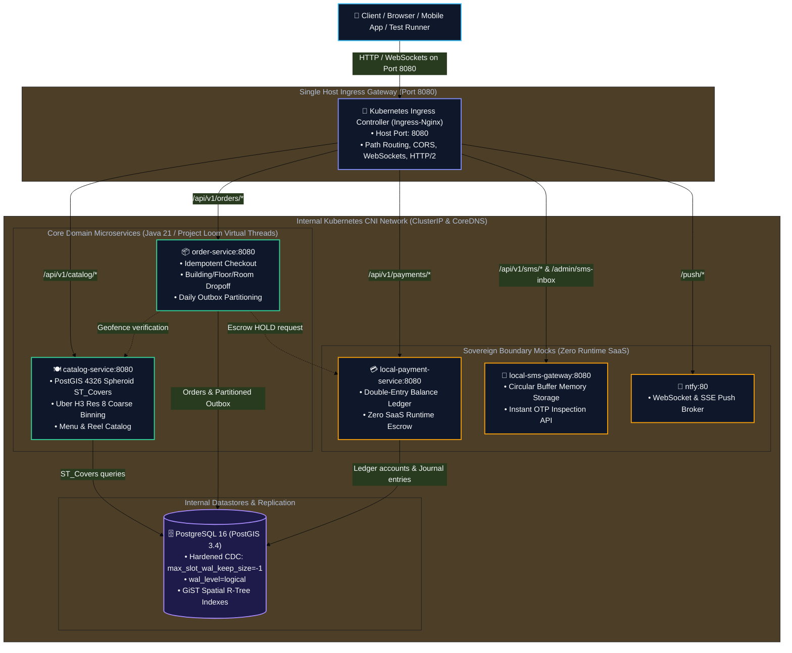

# Sovereign Hyper-Local Video & Food Delivery Platform

**Production-Grade, 100% Offline, Geodesic-Accurate Food & Video Delivery Engine**

[](https://openjdk.org/projects/jdk/21/)
[](https://spring.io/projects/spring-boot)
[](https://postgis.net/)
[](https://kubernetes.io/)
[](https://www.docker.com/)
[](https://opensource.org/licenses/MIT)

---

## 📌 Executive Summary & Architectural Philosophy

Modern on-demand food delivery and dispatch platforms commonly fail when deployed into sovereign, air-gapped, or resource-constrained local development environments. These failures stem from three acute distributed systems anti-patterns:

1. **Latitude Area Distortion in Geospatial Engines:** Most commercial tutorials store delivery boundaries in Web Mercator (`EPSG:3857`). Because Web Mercator projects the Earth onto a flat cylinder, scale distortion accelerates with latitude ($k = \sec\phi$). At $37.77^\circ\text{N}$ (San Francisco), areas are distorted by **$+59.6\%$**; at $51.5^\circ\text{N}$ (London), distortion exceeds **$+158\%$**, falsely rejecting valid customer addresses or including unreachable ocean locations.
2. **Thundering Herd Dispatch Contention:** Broadcasting orders to all couriers simultaneously causes severe lock contention, cellular connection churn, and driver rejection fatigue.
3. **Transactional Outbox WAL Bloat:** High-throughput transactional outbox tables that clean up old events using standard SQL `DELETE` queries trigger massive PostgreSQL MVCC dead-tuple churn, bloat Write-Ahead Logging (WAL), and invalidate downstream Change Data Capture (CDC) replication slots.

This platform resolves these challenges by strictly enforcing six non-negotiable architectural contracts:

```
┌────────────────────────────────────────────────────────────────────────────────────────┐
│                                NON-NEGOTIABLE CONTRACTS                                │
├────────────────────────────┬────────────────────────────┬──────────────────────────────┤
│  1. 100% Sovereign         │  2. Single Host Ingress    │  3. Geodesic CRS Precision   │
│  Zero public cloud SaaS    │  Port 8080 host-bound only │  EPSG:4326 PostGIS only      │
│  Local boundary mocks      │  CNI encapsulated routing  │  ST_Covers on WGS 84 Spheroid│
├────────────────────────────┼────────────────────────────┼──────────────────────────────┤
│  4. Targeted 1-to-1 Lease  │  5. Zero-WAL Outbox Prune  │  6. Hardware Acceleration    │
│  30-second server lock     │  Daily range partitions    │  AMD RX 7900 GRE VCN 4.0     │
│  Optimistic @Version DB    │  DROP TABLE retention jobs │  Mesa VAAPI HLS Transcoder   │
└────────────────────────────┴────────────────────────────┴──────────────────────────────┘
```

---

## 🏛️ System Topology (C4 Level 2: Container Network Interface)

All microservices, databases, and message brokers communicate over the internal Kubernetes **Container Network Interface (CNI)**. Exactly one single port (`8080`) is bound to the host workstation:



---

## 🔬 Core Architectural Breakthroughs

### 1. Geodesic CRS Precision (`geography(Polygon, 4326)` vs `geometry(3857)`)
* Storing service zones in Web Mercator (`EPSG:3857`) introduces up to **$+60\%$** scale distortion at non-equatorial latitudes.
* All service zones and customer coordinates are strictly typed as **`geography(Polygon, 4326)`** and **`geography(Point, 4326)`**.
* Containment queries execute natively on the WGS 84 ellipsoid via `ST_Covers`:
  ```sql
  SELECT r.id, r.name FROM restaurants r
  WHERE r.is_active = true
    AND ST_Covers(r.delivery_zone, ST_SetSRID(ST_MakePoint(-122.4194, 37.7749), 4326)::geography);
  ```
* Unlike `ST_Contains` (which excludes perimeter edges), `ST_Covers` satisfies boundary closure: points lying directly on the delivery border evaluate to `TRUE`.

### 2. Two-Stage Spatial Resolution (Uber H3 Res 8 + PostGIS Fine)
* **Stage 1 (Coarse In-Memory Filter):** Customer coordinates map to a 64-bit integer H3 cell in $O(1)$ CPU time. A 1-ring expansion (`kRing(H3, 1)`) retrieves candidate restaurants within 7 discrete hexagons.
* **Stage 2 (Fine Geodesic Containment):** Only the filtered candidate restaurants are evaluated with PostGIS `ST_Covers`, reducing spatial query latency from $O(N)$ polygon intersections to $O(1)$ indexed integer lookups.

### 3. Zero-WAL Transactional Outbox Partition Pruning
* High-volume order processing writes outbox events within the same ACID transaction as the order.
* Conventional systems run `DELETE FROM outbox_events WHERE created_at < ...`, causing massive PostgreSQL dead-tuple bloat (`n_dead_tup`), autovacuum page-locking, and WAL stream saturation.
* This platform declaratively partitions `outbox_events` by daily range:
  ```sql
  CREATE TABLE outbox_events (
      id UUID NOT NULL,
      aggregate_type VARCHAR(64) NOT NULL,
      aggregate_id UUID NOT NULL,
      event_type VARCHAR(64) NOT NULL,
      payload JSONB NOT NULL,
      created_at TIMESTAMP WITH TIME ZONE DEFAULT NOW(),
      PRIMARY KEY (id, created_at)
  ) PARTITION BY RANGE (created_at);
  ```
* A scheduled daemon drops partitions older than 7 days via **`DROP TABLE <partition_name>;`**. This triggers an OS filesystem `unlink()` on the physical storage file, generating **`n_dead_tup == 0`** and zero WAL amplification.

---

## ⚡ Quickstart & Verification

```bash
# Clone the repository
git clone https://github.com/BlackPool25/delivery-platform.git
cd delivery-platform

# Compile and run the complete test reactor
./mvnw clean test

# Run isolated PostGIS testcontainer verification
./mvnw -pl services/catalog-service test -Dtest=CatalogSpatialVerificationTest
./mvnw -pl services/order-service test -Dtest=OrderOutboxPartitionVerificationTest
```
